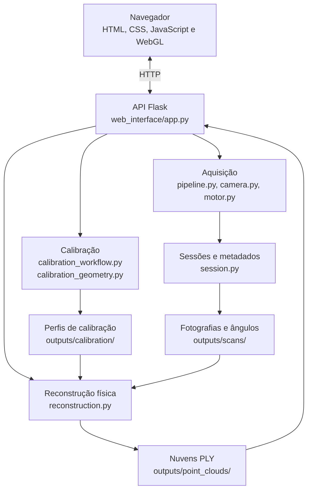

# Scanner3D — Scanner 3D por triangulação a laser

**Protótipo experimental de digitalização tridimensional de baixo custo**, desenvolvido com Raspberry Pi, webcam USB, laser de linha e plataforma giratória. O sistema combina aquisição automatizada, calibração geométrica, reconstrução de nuvens de pontos e uma interface web para operar o equipamento.

**Tecnologias:** Python · Flask · OpenCV · NumPy · gpiozero · HTML · CSS · JavaScript · WebGL

> **Estado do projeto:** a branch `final-polish` contém a implementação para escaneamento físico e reconstrução real em PLY. O equipamento continua sendo um protótipo experimental: a existência de uma nuvem de pontos não garante precisão dimensional, cobertura completa ou uma malha pronta para impressão 3D.

## Visão geral

O funcionamento do scanner segue esta sequência:

1. **Calibração:** determina os parâmetros da câmera, a geometria do eixo de rotação e o plano do laser.
2. **Aquisição:** movimenta a plataforma e registra fotografias associadas aos ângulos comandados.
3. **Reconstrução:** identifica a linha laser nas imagens, calcula pontos tridimensionais e reúne as diferentes vistas.
4. **Visualização:** disponibiliza o arquivo `.ply` para inspeção no navegador, histórico e download.

A câmera e o laser permanecem fixos enquanto o objeto gira. O software é executado no Raspberry Pi; a interface pode ser acessada por outro computador ou celular na mesma rede.

## Funcionalidades implementadas

| Área | Recursos |
| --- | --- |
| **Escaneamento** | Prévia da webcam, início/interrupção de aquisição, controle da plataforma e reconstrução automática após uma sessão física concluída. |
| **Calibração** | Detecção de tabuleiro, cálculo da câmera e do eixo de rotação, estimativa do plano do laser e armazenamento dos perfis geométricos. |
| **Configurações** | Intervalo angular ajustável entre **0,5° e 90°**, pausas de movimentação/captura e persistência das configurações de aquisição. |
| **Resultados** | Exportação de nuvens de pontos **PLY ASCII** com coordenadas XYZ em milímetros e cores RGB estimadas a partir das imagens. |
| **Visualizador 3D** | Visualização WebGL no navegador, rotação, zoom, modo colorido ou monocromático e seleção de arquivos do histórico. |
| **Histórico** | Listagem de sessões, busca, renomeação, exclusão com confirmação e download de PLY. |
| **Diagnóstico** | Estado do scanner, registros de execução, prévias e recursos auxiliares de diagnóstico do laser. |
| **Desenvolvimento** | Modo de simulação separado da triangulação real, testes automatizados e ferramentas de verificação de hardware. |

O intervalo angular configurado representa uma **solicitação**. O programa calcula o número de capturas para completar a volta e distribui os deslocamentos em meios-passos inteiros do motor. Assim, o intervalo físico comandado pode diferir ligeiramente do valor solicitado.

## Arquitetura do software



O diagrama resume o **fluxo físico principal**, não todas as dependências internas. O processamento ocorre no equipamento; o WebGL é utilizado para exibir as nuvens de pontos no navegador.

### Estrutura dos arquivos

```text
scanner3d-raspberrypi/
├── scanner_core/
│   ├── calibration_workflow.py  # Etapas de captura e cálculo da calibração
│   ├── calibration_geometry.py  # Geometria da câmera, eixo e plano laser
│   ├── camera.py                # Comunicação com a webcam
│   ├── motor.py                 # Acionamento do motor 28BYJ-48
│   ├── pipeline.py              # Aquisição e movimentação
│   ├── reconstruction.py        # Triangulação REAL e exportação PLY
│   ├── point_cloud.py           # Gerador demonstrativo (simulação)
│   ├── session.py               # Sessões, arquivos e metadados
│   ├── runtime_settings.py      # Configurações persistentes
│   ├── laser_detection.py       # Máscaras e diagnósticos do laser
│   └── ...                      # Estado, configurações e utilitários internos
├── web_interface/
│   ├── app.py                    # Rotas HTTP / API Flask
│   ├── templates/index.html      # Estrutura da interface
│   └── static/
│       ├── dashboard.css         # Apresentação visual
│       └── dashboard.js          # Interação e visualizador WebGL
├── tests/                        # Testes automatizados
├── tools/                        # Scripts de verificação e diagnóstico
├── docs/                         # Documentos técnicos e históricos
├── requirements.txt
└── README.md
```

**Distinção importante:** `scanner_core/reconstruction.py` processa **fotografias reais** usando dados de calibração e gera o PLY utilizado nos experimentos físicos. Já `scanner_core/point_cloud.py` gera **geometria sintética demonstrativa**; seu resultado não representa um objeto fotografado. Os dois módulos não devem ser confundidos.

## Instalação e execução

**Pré-requisitos gerais:** Git, Python 3 com suporte a ambientes virtuais e uma webcam compatível com OpenCV para testar as etapas de captura. O hardware de rotação e o acesso aos GPIOs são necessários somente para operar a plataforma física no Raspberry Pi.

Todos os comandos devem ser executados **na raiz do repositório**, onde se encontram `requirements.txt` e as pastas `scanner_core` e `web_interface`.

### Windows — PowerShell

Clone diretamente a versão atual:

```powershell
git clone --branch final-polish https://github.com/AugustoSalvego/scanner3d-raspberrypi.git
cd scanner3d-raspberrypi
```

Crie o ambiente virtual, instale as dependências e inicie a aplicação:

```powershell
py -3 -m venv .venv
.\.venv\Scripts\python.exe -m pip install -r requirements.txt
.\.venv\Scripts\python.exe -m web_interface.app
```

Abra **http://127.0.0.1:5000** no navegador.

> **PowerShell:** esses comandos usam o Python do ambiente virtual diretamente, **sem executar `Activate.ps1`**. Portanto, não exigem alteração na política de execução de scripts do Windows.

**Importante:** o Windows é indicado para desenvolver e testar a interface e o processamento que não exige GPIO. Para executar aquisições sem o motor físico, ative o modo de simulação conforme a seção [Modo de simulação](#modo-de-simulação). A simulação ainda utiliza a webcam na etapa de captura; não equivale a um teste inteiramente sem câmera.

### Linux — Ubuntu e Linux Mint

```bash
git clone --branch final-polish https://github.com/AugustoSalvego/scanner3d-raspberrypi.git
cd scanner3d-raspberrypi
python3 -m venv .venv
source .venv/bin/activate
python -m pip install -r requirements.txt
python -m web_interface.app
```

Acesse **http://127.0.0.1:5000**. Se o comando de criação do ambiente virtual não funcionar, instale o pacote `python3-venv` pelo gerenciador de pacotes da distribuição.

Em um notebook sem o conjunto físico conectado, utilize o modo de simulação. A disponibilidade da câmera depende das permissões e dos dispositivos detectados pelo sistema operacional.

### Raspberry Pi — operação física

Conecte a webcam e o circuito do motor ao Raspberry Pi conforme a montagem do protótipo. O código usa **BCM GPIO 17, 27, 22 e 23** para comandar o módulo ULN2003 e o motor 28BYJ-48. O motor deve utilizar alimentação apropriada e **não** ser alimentado diretamente pelos GPIOs.

Se ainda não tiver o repositório:

```bash
git clone --branch final-polish https://github.com/AugustoSalvego/scanner3d-raspberrypi.git
cd scanner3d-raspberrypi
```

Se já tiver uma cópia local na branch `final-polish`, atualize-a **apenas depois de verificar se não há alterações locais pendentes**:

```bash
cd ~/scanner3d-raspberrypi
git status
git fetch origin
git switch final-polish
git pull --ff-only origin final-polish
```

Prepare o Python e execute:

```bash
python3 -m venv .venv
source .venv/bin/activate
python -m pip install -r requirements.txt
python -m web_interface.app
```

No próprio Raspberry Pi, acesse **http://127.0.0.1:5000**. Para abrir a interface em outro dispositivo conectado à mesma rede, descubra o endereço IP do Raspberry Pi:

```bash
hostname -I
```

Depois, acesse `http://IP_DO_RASPBERRY:5000` substituindo o nome pelo IP retornado. A resolução do endereço `scanner.local` depende da configuração de rede e pode não funcionar em todos os ambientes.

**Observação:** a instalação de OpenCV e do acesso aos GPIOs pode exigir ajustes específicos do sistema operacional e da versão do Python instalada no Raspberry Pi. Os comandos acima descrevem o procedimento previsto, mas não substituem a verificação das dependências no dispositivo.

### Encerrar a aplicação

Use **Ctrl+C** no terminal que está executando o servidor Flask. Se o ambiente virtual tiver sido ativado, use `deactivate` para sair dele.

## Operação do scanner

### 1. Calibração

Antes de uma aquisição física, o software precisa de três conjuntos de parâmetros: **câmera**, **eixo de rotação** e **plano do laser**.

1. Posicione o tabuleiro de calibração na plataforma, na orientação indicada pela interface.
2. Informe a dimensão física dos quadrados do padrão. O sistema identifica um tabuleiro com **9 × 6 cantos internos**.
3. Execute a captura e o cálculo da calibração da câmera/eixo.
4. Execute a etapa correspondente ao laser para obter o plano luminoso.
5. Verifique o estado dos perfis na interface antes de iniciar uma aquisição física.

A implementação atual utiliza uma sequência experimental com o tabuleiro em **uma orientação inicial**, obtendo diferentes observações pela rotação. Por isso, a validação geométrica tem limitações; a indicação de perfil salvo não equivale a uma garantia de precisão.

### 2. Aquisição e reconstrução

Após a calibração:

1. Substitua o tabuleiro pelo objeto a ser digitalizado, sem alterar a posição da câmera e do laser.
2. Na seção **Configurações**, selecione o intervalo angular e os tempos de espera.
3. Na seção **Escanear**, inicie a aquisição.
4. O programa registra as fotografias e os ângulos comandados para cada posição.
5. Após uma sessão física concluída, a aplicação executa automaticamente a reconstrução e disponibiliza o arquivo PLY, caso os dados sejam suficientes.

Por exemplo, um intervalo **solicitado** de **5°** corresponde a **72 posições previstas** em uma volta. Isso é apenas uma configuração possível: o usuário pode selecionar outros intervalos dentro da faixa permitida.

O motor utiliza como referência **4.096 meios-passos nominais por volta**. Como não existe encoder para medir a posição real da plataforma, os ângulos registrados são **calculados a partir do movimento comandado**, e não medidos independentemente.

### 3. Visualização e histórico

No painel de visualização é possível abrir nuvens de pontos associadas às sessões, alternar entre cores RGB e apresentação monocromática, girar/aproximar a cena e baixar o arquivo. O histórico permite pesquisar, renomear e excluir sessões.

O visualizador aceita os arquivos **PLY ASCII** gerados pelo sistema. Os resultados são **nuvens de pontos**, não malhas fechadas nem modelos prontos para impressão 3D.

## Modo de simulação

O modo de simulação serve para desenvolver e verificar partes do fluxo sem acionar o motor físico. Ele **não** executa triangulação real: o PLY gerado é apenas demonstrativo. **A captura ainda solicita imagens de uma câmera disponível**.

A opção de simulação está inicialmente **desativada** no código. Para ativá-la com o servidor em execução:

**Windows / PowerShell** — abra outro terminal:

```powershell
Invoke-RestMethod -Uri "http://127.0.0.1:5000/simulation-mode" -Method Post -ContentType "application/json" -Body '{"enabled":true}'
```

**Linux / Raspberry Pi** — abra outro terminal:

```bash
curl -X POST http://127.0.0.1:5000/simulation-mode \
  -H "Content-Type: application/json" \
  -d '{"enabled":true}'
```

Para **voltar ao modo físico**, envie `{"enabled":false}` para o mesmo endpoint. Consulte o estado com `GET /simulation-mode`. A seleção de simulação é mantida em memória durante a execução, enquanto as configurações de intervalo angular e tempos são gravadas em `outputs/settings.json`.

> **Atenção:** nunca utilize um PLY demonstrativo como evidência de reconstrução tridimensional real.

## Arquivos gerados e preservação dos dados

Os arquivos produzidos durante a execução ficam em `outputs/`, que é ignorado pelo Git. A estrutura típica é:

```text
outputs/
├── calibration/
│   ├── camera_calibration.json
│   ├── turntable_calibration.json
│   └── laser_calibration.json
├── scans/
│   └── scan_<identificador_unico>/
│       ├── captures/          # Fotografias da sessão
│       ├── point_clouds/      # Saídas locais, conforme o fluxo
│       └── metadata.json      # Fotografias, ângulos e estados
├── point_clouds/              # PLYs da reconstrução física
├── captures/                  # Capturas manuais
└── settings.json              # Configurações persistentes
```

Cada sessão recebe um identificador único; a hora registrada depende do relógio do sistema. Os metadados associam as fotografias aos ângulos comandados e ao estado do processamento.

**Não exclua `outputs/` para atualizar o projeto.** Essa pasta pode conter calibrações, fotografias e reconstruções que não estão no GitHub. Antes de formatar o equipamento ou trocar de cartão SD, faça uma cópia de segurança desses dados.

## API e documentação

Algumas rotas úteis do servidor Flask:

| Método | Rota | Finalidade |
| --- | --- | --- |
| `GET` | `/` | Interface web |
| `GET` | `/video` | Prévia da câmera |
| `GET` | `/health` | Verificação de disponibilidade |
| `GET` / `POST` | `/settings` | Consultar e alterar configurações |
| `GET` / `POST` | `/simulation-mode` | Consultar ou alterar modo de simulação |
| `POST` | `/start-scan` | Iniciar aquisição |
| `POST` | `/stop-scan` | Solicitar interrupção |
| `GET` | `/api/calibration/workflow` | Consultar estado da calibração |
| `POST` | `/api/calibration/workflow/capture` | Iniciar captura de calibração |
| `POST` | `/api/calibration/workflow/compute` | Calcular calibração |
| `GET` | `/api/sessions` | Listar sessões |
| `GET` | `/api/sessions/<session_id>/ply` | Visualizar/baixar PLY da sessão |
| `POST` | `/api/reconstruction/start` | Iniciar reconstrução física manual |
| `GET` | `/api/reconstruction/status` | Consultar progresso |
| `GET` | `/status` | Estado geral do scanner |

Outras rotas estão implementadas em [`web_interface/app.py`](web_interface/app.py). A pasta [`docs/`](docs/) mantém documentos de arquitetura, API, calibração e planejamento. **Parte dessa documentação registra etapas anteriores do desenvolvimento** e pode não refletir integralmente a branch atual; em caso de divergência, consulte a implementação e este README.

## Testes e ferramentas de desenvolvimento

A pasta [`tests/`](tests/) reúne verificações automatizadas de API, calibração, sessões, reconstrução e interface. A pasta [`tools/`](tools/) contém scripts auxiliares para teste de webcam, GPIO, motor e outros diagnósticos.

A automação em [`.github/workflows/calibration-tests.yml`](.github/workflows/calibration-tests.yml) executa verificações de sintaxe de Python/JavaScript e uma seleção de testes automatizados. Para executar testes Python em um ambiente de desenvolvimento com as dependências instaladas:

```bash
python -m pip install pytest
python -m pytest tests/ -q
```

Os testes de interface em JavaScript utilizam Node.js, conforme indicado no workflow.

**Importante:** testes automatizados e simulações não substituem a avaliação física do motor, da câmera, da calibração e da qualidade dimensional das reconstruções no Raspberry Pi.

## Problemas comuns

| Sintoma | Verificação sugerida |
| --- | --- |
| `Activate.ps1` bloqueado no Windows | Utilize diretamente `.\.venv\Scripts\python.exe`, conforme os comandos acima. |
| `ModuleNotFoundError` ao iniciar | Confirme que as dependências foram instaladas no mesmo ambiente Python usado para executar a aplicação. |
| Câmera não aparece | Verifique conexão USB, permissões, índice da câmera e se outro programa está utilizando o dispositivo. |
| O motor não se movimenta no computador | O acionamento físico depende do Raspberry Pi, GPIOs e circuito apropriado; utilize a simulação fora desse ambiente. |
| A aquisição não inicia no modo físico | Confira os perfis de calibração e se não existe outra operação utilizando o hardware. |
| PLY não é gerado | Verifique se a sessão foi concluída e se o laser ficou visível em fotografias suficientes; consulte mensagens de calibração e reconstrução. |
| `scanner.local` não abre | Descubra o endereço IP do Raspberry Pi com `hostname -I` e acesse a porta `5000`. |
| Modelo não aparece no visualizador | Confirme que a reconstrução terminou e que existe um PLY ASCII associado à sessão. |

## Limitações e próximos passos

O sistema é uma implementação experimental, não um equipamento metrológico certificado. As principais limitações são:

- **Movimento em malha aberta:** não há encoder para confirmar os ângulos realmente percorridos.
- **Calibração:** o procedimento atual utiliza observações com um posicionamento inicial do tabuleiro e possui validação geométrica limitada.
- **Condições ópticas:** materiais reflexivos, oclusões, intensidade do laser e iluminação podem afetar a detecção da linha.
- **Reconstrução:** os arquivos PLY armazenam pontos, sem conectividade de faces ou geração automática de uma malha fechada.
- **Visualização:** o modelo aparece quando o PLY está disponível; uma prévia tridimensional progressiva durante a aquisição ainda requer validação.
- **Desempenho:** tempos, completude e precisão dimensional precisam ser avaliados experimentalmente em cada condição de uso.

Melhorias futuras podem incluir medições independentes da rotação, avaliação quantitativa da calibração, ensaios com objetos de referência e reconstrução de superfícies a partir das nuvens.

## Desenvolvimento acadêmico

O scanner integra um projeto de pesquisa e desenvolvimento em **digitalização tridimensional de baixo custo**. Seu objetivo é investigar a integração entre componentes acessíveis, visão computacional e software próprio, registrando tanto as possibilidades quanto as limitações observadas.

**Autor:** Danilo Augusto Salvego dos Santos  
**GitHub:** [AugustoSalvego](https://github.com/AugustoSalvego)

**Branch documentada:** `final-polish`
